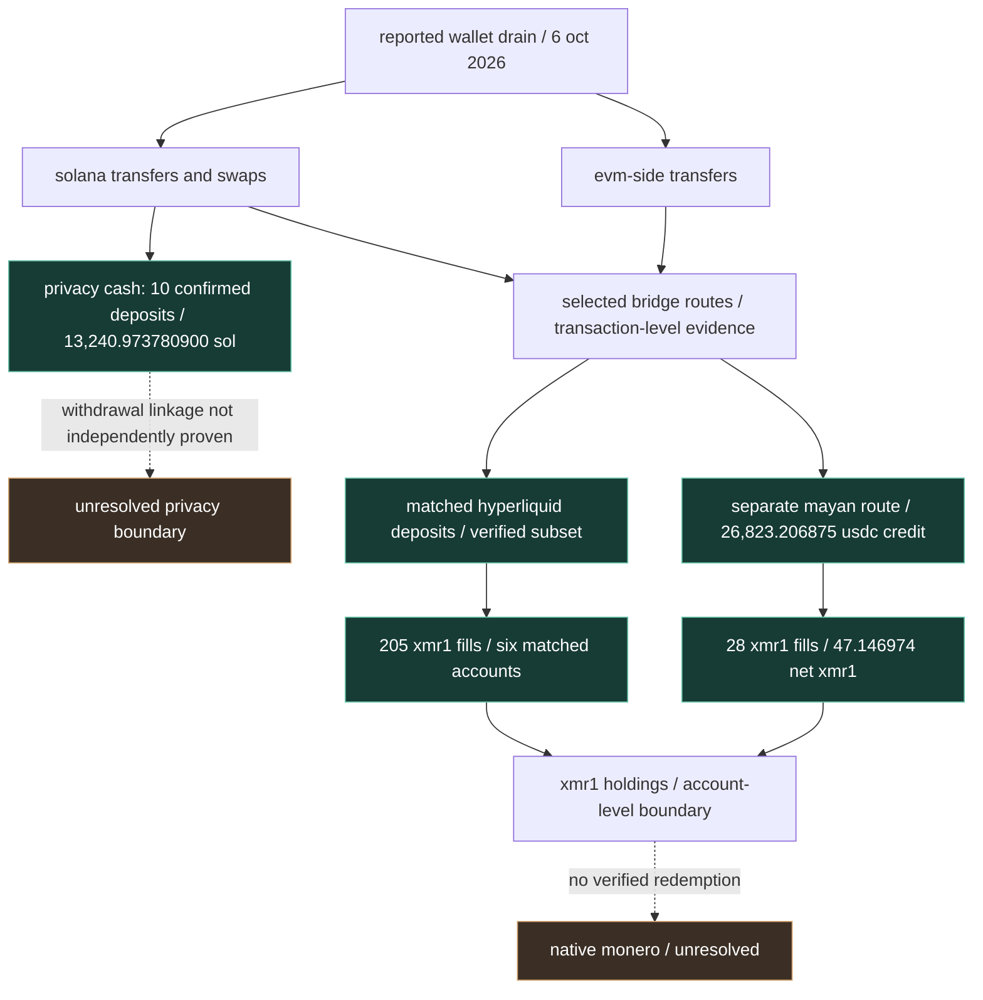

# frogman wallet drain — educational visual evidence

**npc / investigation / 001**  
**editorial update:** 11 november 2026  
**original verified checkpoint:** 10 october 2026 / f0607

> this is an educational reconstruction, not a claim of attribution. diagram arrows show documented sequences or separately labelled reported routes; they do not establish exclusive provenance or common control.

## 01 / the evidence map

**reading the diagram:** these are partial, verified subroutes, not an exhaustive allocation of all victim assets. a protocol deposit, its settlement, a trading credit and the resulting token purchase can represent successive states of the *same* value. never sum them as independent losses.

## 02 / reproducible checkpoints

| id | evidence | status | scope / caveat |
|---|---|---|---|
| f0607 | upstream case provenance | unresolved | no conclusive attribution |
| pc-01 | 10 privacy cash deposits; 13,240.973780900 sol | confirmed | deposit only; not a matched withdrawal |
| hl-01 | six matched hyperliquid credits; 561,850.214994 usdc | confirmed | selected accounts, not all accounts |
| hl-02 | 205 spot fills; 561,824.8582 usdc spent | confirmed | trades on matched accounts |
| hl-03 | separate 26,823.206875 usdc credit | confirmed | mayan-linked account |
| hl-04 | 28 fills; 47.146974 net xmr1 | confirmed | no native monero withdrawal established |
| ext-01 | 35 hyperliquid accounts; ~3,586.8 xmr1 | claimed / external | onchain files snapshot; independent overlap audit pending |
| ext-02 | 41 accounts; ~$2.2m xmr1 | claimed / external | solsentry statement; different coverage/time may explain discrepancy |

## 03 / evidence confidence

- **confirmed:** independently reproduced on-chain transaction or first-party account record within a specified boundary.
- **supported:** evidence supports an interpretation, but is not conclusive.
- **claimed / external:** third-party finding not yet independently reproduced in this archive.
- **unresolved:** no defensible conclusion from available evidence.

## 04 / how to verify a cross-chain route

1. identify the source-chain transaction hash and exact token amount.
2. identify the protocol, order/deposit identifier and source event.
3. match the destination-chain settlement event and its amount, allowing for documented fees.
4. if funds enter an exchange or trading platform, verify the *account credit*, not just a deposit address.
5. reconstruct fills, fees and balances from first-party records.
6. stop at pooled, private or custodial boundaries unless further evidence independently resolves them.

## 05 / questions the evidence cannot answer

a privacy cash deposit does not reveal a withdrawal owner. shared funding does not prove shared control. xmr1 is not a native monero withdrawal. no public wallet trace alone establishes a human identity, compromise method or final beneficiary.

## primary archive and independent sources

- [original npcsignals evidence and methodology](./README.md)
- [v0.2 technical records](./v0.2/)
- [onchain files #014](https://www.onchainfiles.io/scoreboard/) — external 35-account claim, scoreboard snapshot dated 13 october 2026
- [solsentry external account-count statement](https://nitter.gq/crashdiniz) — 41-account claim attributed to an 8 october post; verify against original source before treating as primary
- [source and verification tracker](./EVIDENCE_TRACE_TRACKER.md)

**editorial rule:** no implication that these third-party counts are new november transactions. no november balance or redemption verification has yet been completed.
