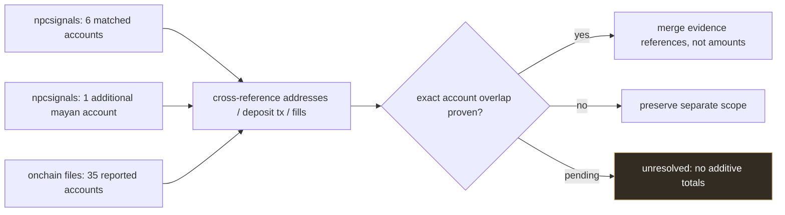
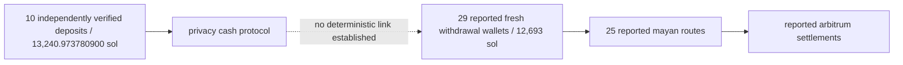

# frogman — external evidence reconciliation / phase 2

**npc / investigation / 001**  
**review date:** 12 november 2026  
**status:** source extraction completed; account-level independent reconciliation pending  
**frozen npcsignals checkpoint:** 10 october 2026 / f0607

## 01 / why the counts differ

the npcsignals archive confirms six matched hyperliquid accounts with 561,850.214994 usdc in credits and a separately documented mayan-linked account with 26,823.206875 usdc. this is a **verified subset**, not a claim that only seven accounts exist.

onchain files #014 reports 35 accounts, 2,029,874 usdc in deposits and 3,586.8 xmr1 held at its last check on 13 october. these larger figures are **external claims** until the addresses and account ledgers are reproduced in our own evidence ledger.

### visual coverage comparison

**never add the seven and 35 account counts or the corresponding usdc totals.** they may overlap, and both may describe different subsets of the same case.

## 02 / transaction-specific external leads

the onchain files #014 ledger provides source links for:
- solana drain transactions at 20:14–20:15 utc on 6 october;
- ten privacy cash deposits at 20:36–21:00 utc;
- 25 mayan bridge routes at 02:27–03:36 utc on 7 october;
- 35 arbitrum hyperliquid deposits (ten evm-side and 25 mayan-side).

these are source-published entries, **not** independently reproduced as part of this 12 november update.

| trace id | utc | stage | external amount | source / evidence |
|---|---|---|---|---|
| ext-f01 | 6 oct 20:14–20:15 | victim wallet transfers | multiple tokens | [onchain files #014, ledger](https://www.onchainfiles.io/files/014-frogman-token2049/) |
| ext-f02 | 6 oct 20:36–21:00 | privacy cash deposits | 13,240.97 sol | [onchain files #014, f2](https://www.onchainfiles.io/files/014-frogman-token2049/) |
| ext-f03 | 6 oct 20:39–21:00 | 29 privacy cash withdrawals | 12,693 sol | **inferred by external source**, no proven deposit-to-withdrawal link |
| ext-f04 | 7 oct 02:27–03:36 | 25 mayan routes | 1,284,323 usdc delivered | external protocol-record claim |
| ext-f05 | 7 oct 01:45 onward | 10 evm / li.fi routes | 745,551 usdc | external route reconstruction |
| ext-f06 | 7 oct by 03:37 | 35 hyperliquid accounts | 2,029,874 usdc deposited | external account inventory |
| ext-f07 | last check 13 oct | xmr1 balances | 3,586.8 xmr1 | **dated snapshot**, not november balance |

the external route totals (1,284,323 + 745,551) equal 2,029,874 usdc as reported. this is an arithmetic consistency check only, not independent transaction verification.

## 03 / privacy cash evidence boundary

the dotted edge is deliberately unproven. withdrawal timing and denominations can support a hypothesis, but cannot identify the withdrawing party or establish that all funds came from the victim.

## 04 / independent reproduction checklist

- [ ] extract all 35 complete arbitrum addresses from the external ledger.
- [ ] capture full transaction hashes, token contract, decimals, block numbers and utc times.
- [ ] match each account to the npcsignals v0.2 ledger; record exact matches and unmatched addresses.
- [ ] reproduce 35 hyperliquid credits and subsequent xmr1 fills from first-party account records.
- [ ] re-query balances, transfers, redemptions and withdrawals at a timestamped november checkpoint.
- [ ] resolve whether the separately reported 41-account inventory has additional addresses or different inclusion criteria.
- [ ] verify any wagyu redemption independently; do not equate xmr1 purchase with native monero transfer.
- [ ] publish a machine-readable reconciliation table with evidence urls and checksums.

## 05 / external primary links and limitations

- [onchain files #014 — original case record, evidence map and transaction ledger](https://www.onchainfiles.io/files/014-frogman-token2049/)
- [onchain files scoreboard — dated monitored balances](https://www.onchainfiles.io/scoreboard/)
- [npcsignals public record](./README.md)
- [npcsignals visual evidence](./EDUCATIONAL_VISUAL_EVIDENCE.md)
- [npcsignals trace tracker](./EVIDENCE_TRACE_TRACKER.md)

**as of this editorial update:** no fresh first-party hyperliquid account-state audit has been completed. no confirmed november withdrawal, redemption, recovered funds or human attribution is established. no outside account totals are promoted to independently confirmed status.
