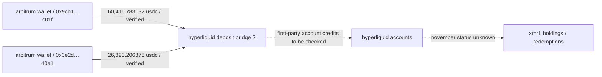

# frogman — primary transaction spot checks / 12 november 2026

**npc / investigation / 001**  
**scope:** two independently inspected arbitrum explorer transaction receipts  
**status:** confirmed on-chain deposits; post-deposit activity not rechecked

## verified transaction records

| id | utc | block | from | usdc amount | transaction |
|---|---|---:|---|---:|---|
| arbi-01 | 2026-10-07 01:45:30 | 512421104 | `0x9cb119168265469a849E1864c87a57999A4Bc01f` | 60,416.783132 | [arbiscan](https://arbiscan.io/tx/0xc0e57329de131312e346161d70d2e7eb4626f12b4ed642af6b1def28d813669f) |
| arbi-02 | 2026-10-07 02:21:11 | 512429504 | `0x3E2d81f7A5659e4760bA929ef88eed40EF6640a1` | 26,823.206875 | [arbiscan](https://arbiscan.io/tx/0x963c56253dedcfd5ff9f944c91eb9cb9e94d12701d9165f66a40b9aa0b4cfc1f) |

both transactions show successful usdc token transfers to `0x2Df1c51E09aECF9cacB7bc98cB1742757f163dF7` (labelled hyperliquid deposit bridge 2), using arbitrum usdc contract `0xaf88d065e77c8cC2239327C5EDb3A432268e5831`.

## independent reconciliation

- **arbi-02:** 26,823.206875 usdc matches the exact separately documented npcsignals mayan-related hyperliquid credit amount. amount agreement and recipient label support the match, but the full route and first-party account credit should still be cross-checked by transaction hash.
- **arbi-01:** 60,416.783132 usdc confirms the external source's rounded 60,417 usdc deposit, not the account's subsequent fills or ultimate controller.
- **two confirmed transactions do not validate the complete 35-account inventory** or its reported 2,029,874 usdc total.

## verification boundaries

confirmed: successful arbitrum transactions, exact usdc amounts, originating wallets, block times, token contract and deposit-bridge recipient.

not checked here: hyperliquid first-party credit matching for arbi-01, all 35 unique accounts, post-october transfers, current xmr1 balances, redemption to native monero, human attribution.

## educational trace

**source dates:** the transactions occurred 7 october; the verification review was conducted 12 november. this is not evidence of new november fund movements.

## next steps

1. inspect remaining 33 deposit receipts from the published external ledger.
2. retrieve complete address inventory and compare with the npcsignals v0.2 findings.
3. verify hyperliquid account credits, fills and withdrawals from first-party records at a timestamped current checkpoint.
4. avoid promoting third-party reported balances to independently confirmed findings without reproduction.

## additional verified receipts — 12 november 2026

The following three receipts were inspected directly on Arbiscan. Each shows a successful Arbitrum USDC transfer to Hyperliquid Deposit Bridge 2 (`0x2Df1c51E09aECF9cacB7bc98cB1742757f163dF7`).

| id | utc 7 oct 2026 | block | originating address | exact usdc | full transaction hash |
|---|---|---:|---|---:|---|
| arbi-03 | 01:49:41 | 512422057 | `0xd7efd720aDf271B7173Dd01a9b81668892Bee6B1` | 100,542.304581 | [arbiscan](https://arbiscan.io/tx/0xd09044916f0e5402351d6edc68cc7afa48a00e08800791a02e0f48f554f1255e) |
| arbi-04 | 01:52:53 | 512422775 | `0x68d6E20a28F9d50Ebf798ccf9fae9e3D5e4F1ac4` | 93,738.289817 | [arbiscan](https://arbiscan.io/tx/0x953cb3206cf345b500e518316a07151f10835663ce4e55f8e972d2d78e78ff87) |
| arbi-05 | 01:56:40 | 512423646 | `0x888795F84f5F81352a7639f1254662ae5897E223` | 93,549.620787 | [arbiscan](https://arbiscan.io/tx/0x0ddf411d8745a28b5efdd1c42ab0a1526c53f1c92b622b36c0f6baf595dc3a9c) |

**progress:** 5 of 35 externally reported deposit transactions checked individually, 30 outstanding. The Arbitrum transfers alone do not verify first-party Hyperliquid credit/fills, current account holdings, redemption, common control or attribution. Do not add the five deposits to the external 2,029,874 USDC figure: they are a subset.

## further receipt checks — 12 november 2026 (arbi-06 through arbi-10)

Five additional externally listed Arbitrum transactions were inspected against Arbiscan's transaction details and ERC-20 transfer events. Each has **Success** status and transfers native Arbitrum USDC (contract `0xaf88d065e77c8cC2239327C5EDb3A432268e5831`) to the address labelled Hyperliquid Deposit Bridge 2 (`0x2Df1c51E09aECF9cacB7bc98cB1742757f163dF7`).

| id | utc 7 oct 2026 | block | sender | exact usdc | explorer |
|---|---|---:|---|---:|---|
| arbi-06 | 02:05:09 | 512425661 | `0xa3cA6199D8692eC40d0287e615b48d0e8cdE9abe` | 91,232.216513 | [receipt](https://arbiscan.io/tx/0x107db810fd86893dc4cf8df03c1753236e04fc2d7b3f17304b34dfb840c1fa51) |
| arbi-07 | 02:09:51 | 512426794 | `0x4079067aa1BdfF060c6C45155966D81C79e754e9` | 91,353.381339 | [receipt](https://arbiscan.io/tx/0x0ed5e25dfa5a8a702349a7c05c6e6afe28fd4161ad4c87c056a0460bef9056c6) |
| arbi-08 | 02:13:35 | 512427700 | `0x68B3A77db46418905C7eaf63324d4adCcE06A680` | 91,283.855105 | [receipt](https://arbiscan.io/tx/0xe295cfe85f341c4abb36c74a22ea62c767788712410f7d10df4b55abcad99b85) |
| arbi-09 | 02:18:05 | 512428778 | `0xd9249DE6224382CE7791600d1D1F9E5fDF633abB` | 91,382.763365 | [receipt](https://arbiscan.io/tx/0xdffada3de106b8639c6af7e25fc106e075f1c1b02f9ffd8e6facb70413bcf0d8) |
| arbi-10 | 02:19:24 | 512429103 | `0xd8D06aEcFB5dE45D0dcb655DE57650d0231B0Ef5` | 5,228.747925 | [receipt](https://arbiscan.io/tx/0x36e8c7e021615d79470419f7939ded6ac67db60b4db5c4ae8795be13dea311d7) |

**cumulative scope:** 10 / 35 external deposit transaction receipts individually inspected; 25 remain. This verifies transaction execution, not account-level credits, subsequent trades, current balances or human control. Do not sum these values as new losses.

**editorial note:** all transactions occurred in october; the review date is november. There is no confirmed new november fund movement in these five receipts.

## additional direct explorer checks — arbi-11 to arbi-15 (12 november 2026)

Each Arbiscan transaction page reports **Success** and an ERC-20 transfer of native Arbitrum USDC (`0xaf88d065e77c8cC2239327C5EDb3A432268e5831`) to Hyperliquid Deposit Bridge 2 (`0x2Df1c51E09aECF9cacB7bc98cB1742757f163dF7`). Times refer to **7 october 2026 UTC**, not new november transfers.

| id | time utc | block | from | usdc | source |
|---|---|---:|---|---:|---|
| arbi-11 | 02:28:45 | 512431230 | `0x3b80EEB4bdCebdd93dbbBE16758020e07F41a65C` | 39060.017148 | [arbiscan](https://arbiscan.io/tx/0xfb53cfae8da01080872d645803f8e697e8a864a98a16a0ddbd3e8d1acdc47267) |
| arbi-12 | 02:29:24 | 512431372 | `0x1137e3fdF575bD635dB491c2B60B5DAc7ae74371` | 39037.205601 | [arbiscan](https://arbiscan.io/tx/0x4e91e92e22531f398718516843815a9e5e678108c02d176aef46681480a5a3bc) |
| arbi-13 | 02:31:02 | 512431736 | `0x1B1C3046fa9DFC9d5eF66BF00D62A777044F829c` | 39023.538376 | [arbiscan](https://arbiscan.io/tx/0xc51e075dce89cfa5d2ff41c9d75a3ae28770cf72ca6e3c9ad78f45ddadd7a537) |
| arbi-14 | 02:32:17 | 512432029 | `0x97bFc50655ae2f06eD26EC5C67F476D2BDD0308f` | 39091.006653 | [arbiscan](https://arbiscan.io/tx/0xae5ffb5aa2732bf327772e35fa7523e730006d926a3494a17deb20286b7bafcc) |
| arbi-15 | 02:33:35 | 512432326 | `0x3Bc6095627E177E7C4C7Bf3f0E3C5182625ed81d` | 39091.478119 | [arbiscan](https://arbiscan.io/tx/0xc67cb35c17bca0d12db1c9118b6a97a6957f6ae0b2fa1127681f6baf3c029931) |

**subtotal of these five:** 195,303.245897 USDC. This is a subset of externally reported deposits, not an additional loss. The five full transaction hashes and sender addresses are distinct. This establishes the Arbitrum token transfers only; Mayan source-side settlements, first-party Hyperliquid account credits, XMR1 trades, withdrawals and November balances are not established by these receipts.

**progress:** 15 of 35 externally reported deposit transactions inspected, 20 pending. Preserve the original independently verified 10 october checkpoint.

## direct explorer verification — arbi-16 to arbi-20 (12 november 2026)

All five transactions show Success and native Arbitrum USDC transfers to Hyperliquid Deposit Bridge 2. The dates below are historical 7 october UTC timestamps.

| id | time utc | block | sender | usdc (exact) | explorer |
|---|---|---:|---|---:|---|
| arbi-16 | 02:43:52 | 512434626 | `0x278D8D16F49e88F3D706A804c6DA24c6FEcCB3F0` | 39178.420630 | [transaction](https://arbiscan.io/tx/0xdbf8f5abda55c8d6cb2b2644018d0e0f9acd0f79f12a2dc62e4d33a65aee6533) |
| arbi-17 | 02:46:35 | 512435221 | `0x122BC1C10b2DdBa24dfA793Ea7fA3FB2f934Ce58` | 48940.066463 | [transaction](https://arbiscan.io/tx/0xcf6f66118d59eb9e52f550e2b2bfa1731619319d0e529cb83222f7ceb87d5d77) |
| arbi-18 | 02:47:40 | 512435464 | `0x9B3b38F9969dEe372c31549f33F66f8384D237a5` | 48899.340289 | [transaction](https://arbiscan.io/tx/0x5182919313ca43a68fbe726459f517989f2dd89215a0a259112cdb89664e1896) |
| arbi-19 | 02:51:49 | 512436386 | `0x8FF77D08460A885E10131F124422Dfe1C00aD4c3` | 48919.974918 | [transaction](https://arbiscan.io/tx/0xfa481712ae1e5a19bb86b053b9735d5a15c88b4138337b6deb0b27024aaf6f35) |
| arbi-20 | 02:53:38 | 512436790 | `0xe120D6d7042faBB3376F27E0E3351d7f3b913c0E` | 48894.883204 | [transaction](https://arbiscan.io/tx/0xed9cc64e93d490aa9bc002d33f7d89502f38793d16bb3d9f0dd081fcc2320899) |

**scope:** 20 of 35 published Arbitrum deposit transactions individually inspected; 15 remain. No first-party Hyperliquid balance or redemption verification has been performed. The amounts are already part of the external inventory and must not be added as new losses.
