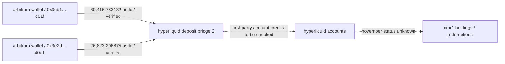

# frogman — primary transaction spot checks / 12 november 2026

**npc / investigation / 001**  
**scope:** two independently inspected arbitrum explorer transaction receipts  
**status:** confirmed on-chain deposits; post-deposit activity not rechecked

## verified transaction records

| id | utc | block | from | usdc amount | transaction |
|---|---|---:|---|---:|---|
| arbi-01 | 2026-10-07 01:45:30 | 512421104 | `0x9cb119168265469a849E1864c87a57999A4Bc01f` | 60,416.783132 | [arbiscan](https://arbiscan.io/tx/0xc0e57329de131312e346161d70d2e7eb4626f12b4ed642af6b1def28d813669f) |
| arbi-02 | 2026-10-07 02:21:11 | 512429504 | `0x3E2d81f7A5659e4760bA929ef88eed40EF6640a1` | 26,823.206875 | [arbiscan](https://arbiscan.io/tx/0x963c56253dedcfd5ff9f944c91eb9cb9e94d12701d9165f66a40b9aa0b4cfc1f) |

both transactions show successful usdc token transfers to `0x2Df1c51E09aECF9cacB7bc98cB1742757f163dF7` (labelled hyperliquid deposit bridge 2), using arbitrum usdc contract `0xaf88d065e77c8cC2239327C5EDb3A432268e5831`.

## independent reconciliation

- **arbi-02:** 26,823.206875 usdc matches the exact separately documented npcsignals mayan-related hyperliquid credit amount. amount agreement and recipient label support the match, but the full route and first-party account credit should still be cross-checked by transaction hash.
- **arbi-01:** 60,416.783132 usdc confirms the external source's rounded 60,417 usdc deposit, not the account's subsequent fills or ultimate controller.
- **two confirmed transactions do not validate the complete 35-account inventory** or its reported 2,029,874 usdc total.

## verification boundaries

confirmed: successful arbitrum transactions, exact usdc amounts, originating wallets, block times, token contract and deposit-bridge recipient.

not checked here: hyperliquid first-party credit matching for arbi-01, all 35 unique accounts, post-october transfers, current xmr1 balances, redemption to native monero, human attribution.

## educational trace

**source dates:** the transactions occurred 7 october; the verification review was conducted 12 november. this is not evidence of new november fund movements.

## next steps

1. inspect remaining 33 deposit receipts from the published external ledger.
2. retrieve complete address inventory and compare with the npcsignals v0.2 findings.
3. verify hyperliquid account credits, fills and withdrawals from first-party records at a timestamped current checkpoint.
4. avoid promoting third-party reported balances to independently confirmed findings without reproduction.
