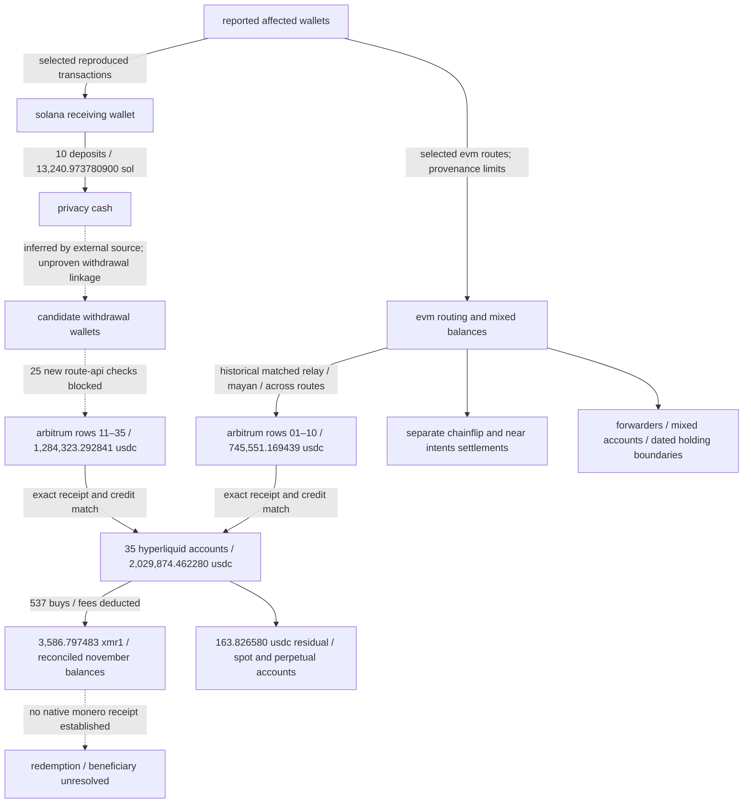
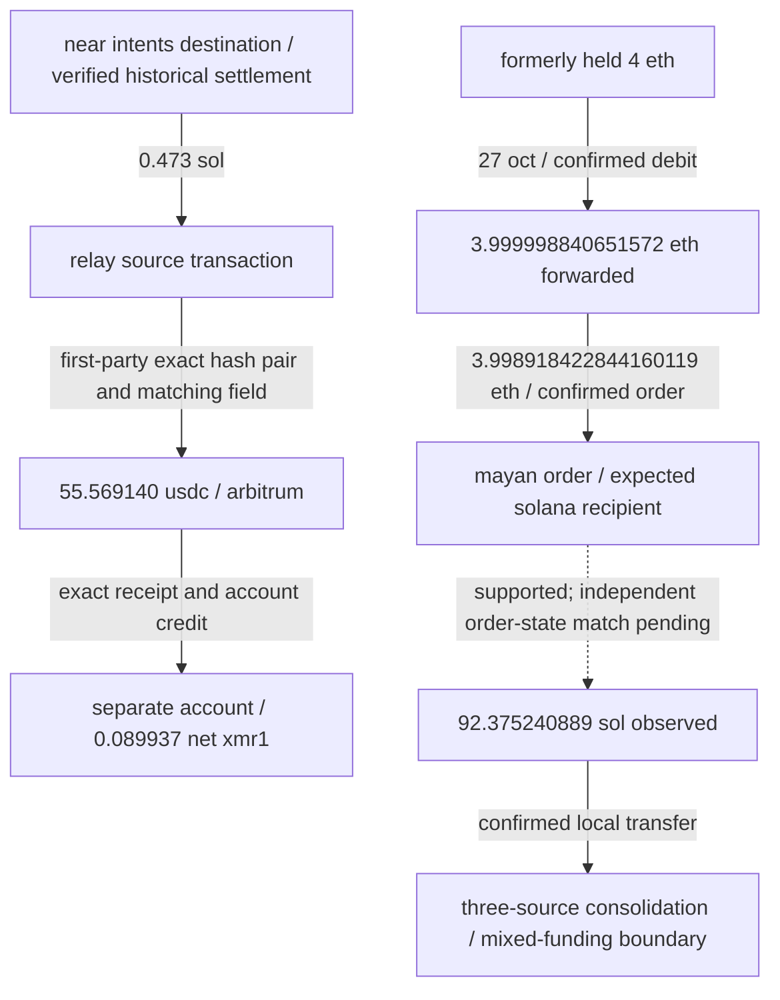

# frogman / visual timeline and evidence flow

## chronological record

```mermaid
timeline
 title frogman / utc evidence chronology
 6 oct 20:14:54 : earliest reproduced suspicious solana outflow
 6 oct 20:18–20:35 : token disposals and conversion
 6 oct 20:36–21:00 : ten privacy cash deposits / 13,240.973780900 sol
 6 oct 23:40 : reproduced base to ethereum across route
 7 oct 01:13–01:36 : near intents and chainflip settlements / separate branches
 7 oct 01:45–03:37 : 35 arbitrum usdc deposits and matched hyperliquid credits
 7 oct 03:37:25 : last activity returned across the 35 accounts
 10 oct : original npcsignals research checkpoint
 13 oct : external monitor's stated last check
 27 oct : formerly held eth spent / new mayan order
 13 nov : 35-account receipt, credit, fill and balance reconciliation
```

## money-flow map



solid edges refer to reproduced evidence within the attached scope. dotted edges are unresolved or inferred. the diagram does not establish an uninterrupted path from every victim asset to every hyperliquid balance. row group labels preserve the external grouping without upgrading private-pool attribution. successive protocol inputs, settlements, credits and purchases must not be added as new losses.

## inspect an arrow

- privacy cash entry: [original deposits](../frogman_research_v0_1/privacy_cash_deposits.csv).
- evm routes: [v0.2 evidence](../v0.2/), including route-specific `cross_chain_edges.json` and verifiers.
- all arbitrum → hyperliquid arrows: [35-account audit](ACCOUNT_AUDIT.md), [receipts](receipts.json), exact receipt/transaction/block/ledger files in [raw](raw/).
- hyperliquid → xmr1: [all 537 fills](fills.json), [metadata](raw/spotMeta.json), [account reconciliation](accounts.json).
- residual balances and no returned external-transfer entries: [ledger](ledger.json), individual spot/perpetual states and query metadata in [raw](raw/).

## additional routes / do not merge with the external 35



[additional route evidence and exact timestamps](ADDITIONAL_FINDINGS.md). the last arrow does not identify a final beneficiary or allocate later spending from the mixed balance.
