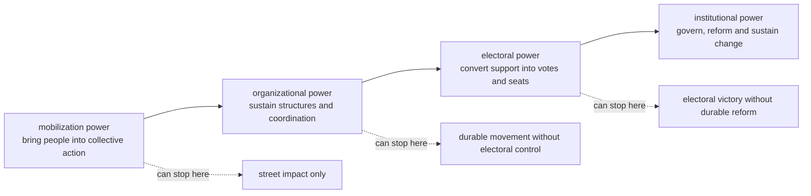
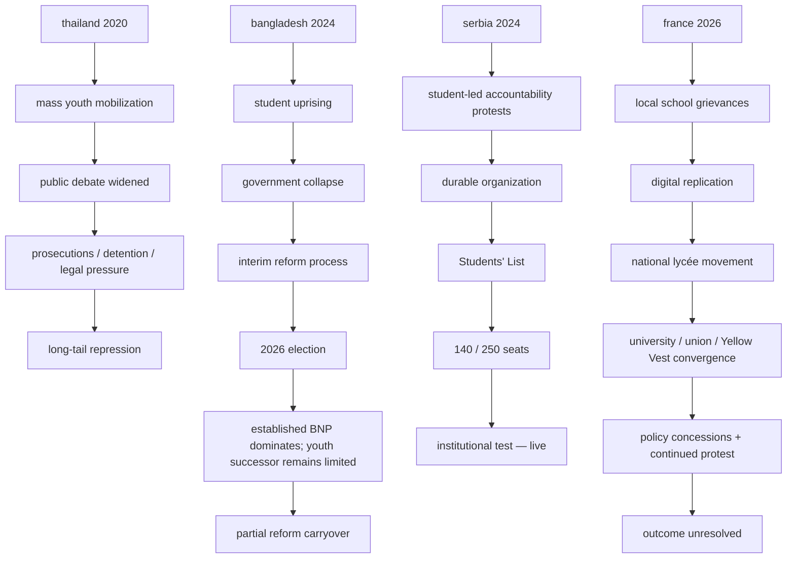
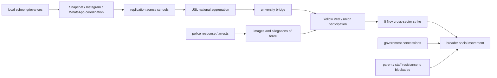
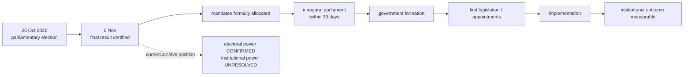
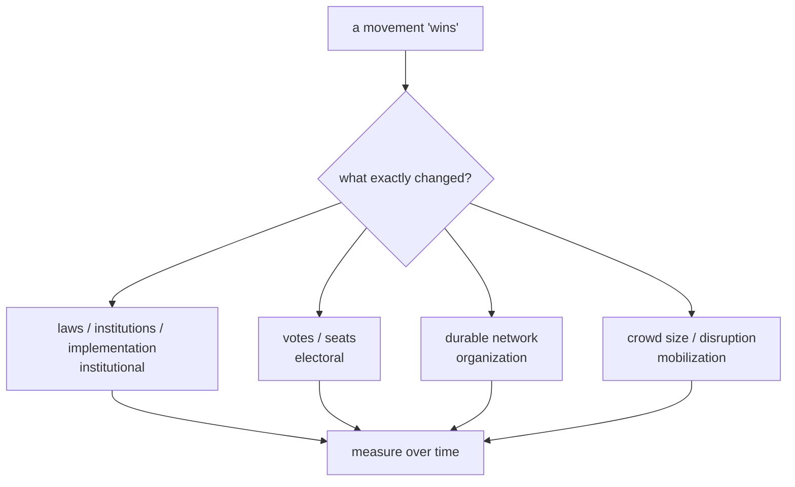

# visual timelines and comparison diagrams

version: **0.3**

these diagrams are navigation aids. they summarize claims documented elsewhere in the archive and should not be used as a substitute for the case files or evidence ledger.

## 1 / four forms of power

## 2 / comparative pathways

## 3 / france scaling sequence

## 4 / serbia institutional transition

## 5 / what counts as success?

## use in teaching

the diagrams are intended to help readers ask the correct question:

**when a protest appears successful, which form of power has actually been achieved?**
