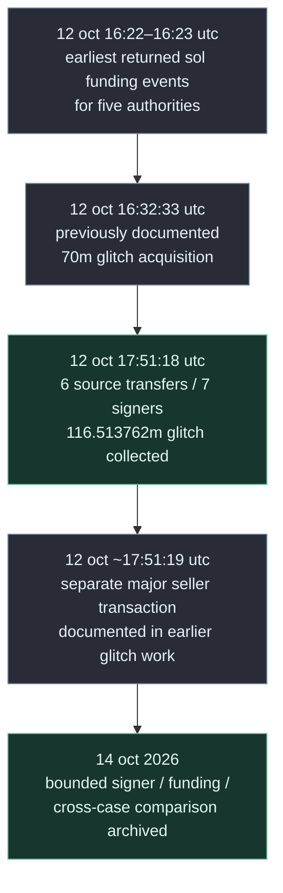
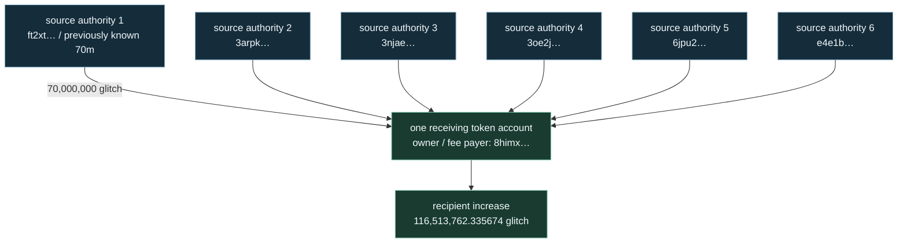
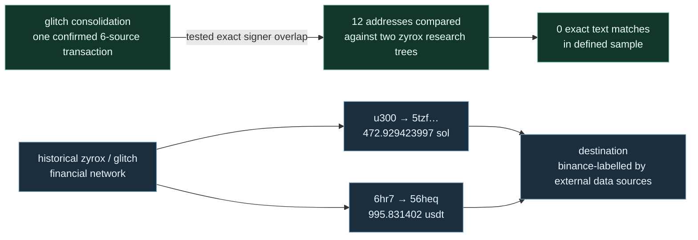

# six wallets. seven signers. one transaction.

> npcsignals / visual evidence story / glitch × zyrox / 12–14 october 2026

**original article:** [six wallets. seven signers. one transaction.](https://medium.com/@npcsignals/six-wallets-seven-signers-one-transaction-4c95601a555a) · **technical baseline:** [control-attribution evidence package](./README.md) · **research cutoff:** 14 october 2026.

## 01 / what happened — the short version

on **12 october 2026 at 17:51:18 utc**, **six source token accounts** sent **116,513,762.335674 glitch** to **one receiving token account**, in **one solana transaction** (slot **456135125**). **seven public keys signed**: six source authorities and the receiving account owner, who also paid **35,700 lamports** in transaction fees. the destination's balance increased by exactly the transferred amount.

this is **confirmed transaction-level coordination**. it is **not proof that one human or company owned all seven keys**. the detailed transaction and account balances are preserved in the accompanying [receipt audit](./consolidation-audit.json).

| figure | directly documented scope |
|---|---|
| **6** | source token accounts / six separately authorized token transfers |
| **7** | transaction signer public keys, including recipient owner / fee payer |
| **116,513,762.335674 glitch** | aggregate tokens moved in the consolidation; **not** seven different transfers of this value |
| **35,700 lamports** | one fee paid by the recipient owner, **not a fee for each source** |
| **0 exact address matches** | bounded text comparison of 12 examined keys with two baseline zyrox research trees; does not exclude all other links |

[open the primary solana transaction](https://solscan.io/tx/3ttmcRNck85nUEcnaTZ3nmMWpq9sAdCwjq8EF56Zz4wzsi3dz2AB1G18FibKKmqNzShVexFVanogoAUSJeJXojy1)

## 02 / the event sequence



the five histories contain **96 finalized transaction references** across the sampled account keys, all returned references dated 12 october. empty older pages were returned. that is a **limited retrieval result**, not proof that relevant token accounts were never used earlier. [history scope](./history-scope.json) · [technical README](./README.md).

**important chronology limit:** the article mentions a reported telegram contract-address disclosure around **16:24 utc**, but other statements about timing and token acquisition are not sufficient to certify the *first public disclosure* time. the first independently established public-availability moment is **unresolved** here. do not convert a social-media timing claim into proof of insider access.

## 03 / one transaction, six separately authorized movements



the five additional source transfers total **46,513,762.335674 glitch**, in addition to the known **70m** purchaser route. all six source balances fell to zero. the receiving account balance changed from **2,936,950.790841** to **119,450,713.126515 glitch**:

```text
  70,000,000.000000  earlier-identified source
+ 46,513,762.335674  five additional sources
------------------
 116,513,762.335674  consolidated token movement

 119,450,713.126515  receiver after
-  2,936,950.790841  receiver before
------------------
 116,513,762.335674  exact observed delta
```

**why seven signatures matter:** the six source authorities authorized debits of their own token accounts. the receiving owner signed the same transaction and paid the fee. the record therefore shows **coordinated execution**, rather than six transfers merely occurring in the same minute. it does not reveal whether the keys belonged to one actor, several collaborators or an assembly service.

**do not call this a formal multisig account.** several transaction signers in one solana transaction are not the same as a verified formal multisig configuration.

evidence: [consolidation audit](./consolidation-audit.json) · [new CA001–CA010 ledger](./new-evidence-ledger.json) · [original rpc response](./raw/3ttmcRNck85nUEcnaTZ3nmMWpq9sAdCwjq8EF56Zz4wzsi3dz2AB1G18FibKKmqNzShVexFVanogoAUSJeJXojy1.rpc.json).

## 04 / which parts relate to zyrox?

the article and its source archive contain **two different types of findings**:



**the diagram separates two historic routes; it does not assert that u300 and 6hr7 were the same wallet, or that the routes combined at the same customer account.**

### route a / u300

the wallet `8zHcWujHhyJri3CRTcWUGmT5WSRdwW7xrns3WTTkPGvS` made **four finalized sol transfers totaling 472.929423997 sol** to `5tzFkiKscXHK5ZXCGbXZxdw7gTjjD1mBwuoFbhUvuAi9`. **bitquery and solscan publicly label the destination as binance-associated infrastructure**; this label is **supported attribution**, not direct confirmation of beneficial ownership or internal exchange crediting. **three transfers predate the zyrox creator purchase**, and their value cannot be launch proceeds. the fourth transfer is subject to mixed-balance limits.

### route b / 6hr7 → 56heq

on 24 september, historical transfers totaling **995.831402 usdt** were authorized from case wallet `6hR7GwHpdHbJgNJAagm64KMsMYu8mR6ExzmbE5N8wv1N` to a token account historically controlled by `56HEQykziUkwvpK5uPzFrRbGD4Ek8HdWgjgeDvNmDoEJ`. later, 56heq authorized a **995.831502 usdt** transfer to a token account historically owned by the binance-labelled address above; a separate **0.000100 usdt** inflow explains the difference. this **predates both token launches** and cannot be portrayed as proceeds from them.

see [technical control-attribution README](./README.md) · [binance v2 historical evidence package](../../evidence/binance-v2.0-2026-10-14/README.md) · [claim and chain comparison](../../glitch-investigation/GLITCH_ZYROX_claim_vs_chain_audit_v0.2.md).

## 05 / the common-operator hypothesis

| question | result | permitted conclusion |
|---|---|---|
| were six source transfers included in one transaction? | **confirmed** | coordinated execution at transaction level |
| did the recipient owner pay the fee? | **confirmed** | fee payer participated; **not** proof of control over other keys |
| did the 12 examined keys exactly match addresses in the bounded zyrox text corpus? | **no matches** | negative **within that sample**; not a universal absence of links |
| did both token creation records reference a shared pump.fun mint authority? | **observed, infrastructure explanation supported** | not a common human signer |
| did historical financial transfers reach binance-labelled infrastructure? | **documented transfers; supported label** | not proof of exchange customer identity or token-sale proceeds |
| is one person or entity proven to control both launches? | **unresolved** | do not assert common ownership, fraud or an identified beneficiary |

the shared mint authority `TSLvdd1pWpHVjahSpsvCXUbgwsL3JAcvokwaKt1eokM` is described by solscan as pump.fun token mint infrastructure and **did not appear as a transaction signer** in the reviewed creation receipts. public infrastructure overlap is not evidence of personal control.

## 06 / what students and researchers can verify

**start with the question:** why does a blockchain prove that multiple authorizations were used without telling us *who* supplied the keys?

1. open the [solana transaction](https://solscan.io/tx/3ttmcRNck85nUEcnaTZ3nmMWpq9sAdCwjq8EF56Zz4wzsi3dz2AB1G18FibKKmqNzShVexFVanogoAUSJeJXojy1), find the **seven signer keys**, and inspect the **six token transfers at outer instruction indices 2–7**.
2. compare [source/recipient balances](./consolidation-audit.json) with [the raw rpc receipt](./raw/3ttmcRNck85nUEcnaTZ3nmMWpq9sAdCwjq8EF56Zz4wzsi3dz2AB1G18FibKKmqNzShVexFVanogoAUSJeJXojy1.rpc.json).
3. inspect [the CA ledger](./new-evidence-ledger.json): new five source transfers vs the pre-existing 70m are deliberately distinguished to prevent duplicate counting.
4. examine the [exact-address comparison](./exact-address-comparison.json) and its explicit scope; a zero-match result does **not** establish independence of the entire launch networks.
5. verify [preservation and reproducibility](./SHA256SUMS.json) and read [the limitations](./README.md).

**definitions:** *source authority* means a public key authorizing the debit of a token account; *fee payer* pays transaction costs; *token account* is a balance-holding account for a specific token; *signer* supplies a required digital signature; *rpc response* is data returned by a blockchain node endpoint. none of these terms alone means human identity or beneficial ownership.

**quality and boundaries:** the original examination used **one solana rpc provider**, with separate finalized status checks, retained request/response records and a bounded address comparison. the case does not independently verify raw block signatures through a second provider. the audit of a separate 384-file archive is **not** a new independent audit of this particular consolidation.

**conclusion:** six source accounts, seven signers, one transaction. **coordinated execution is visible. common ownership remains unresolved.**

*the transaction is visible. the operator is not.*
