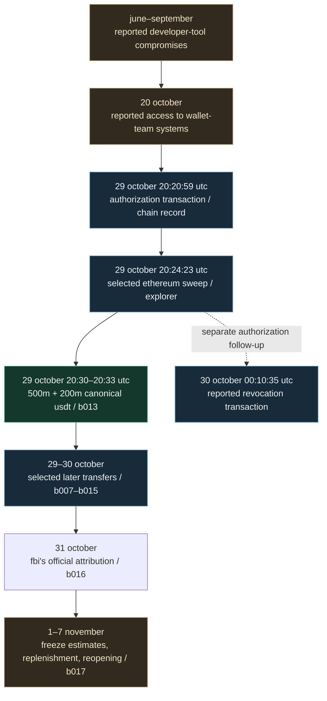
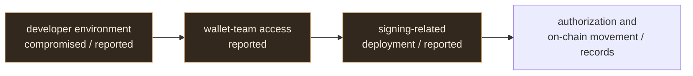
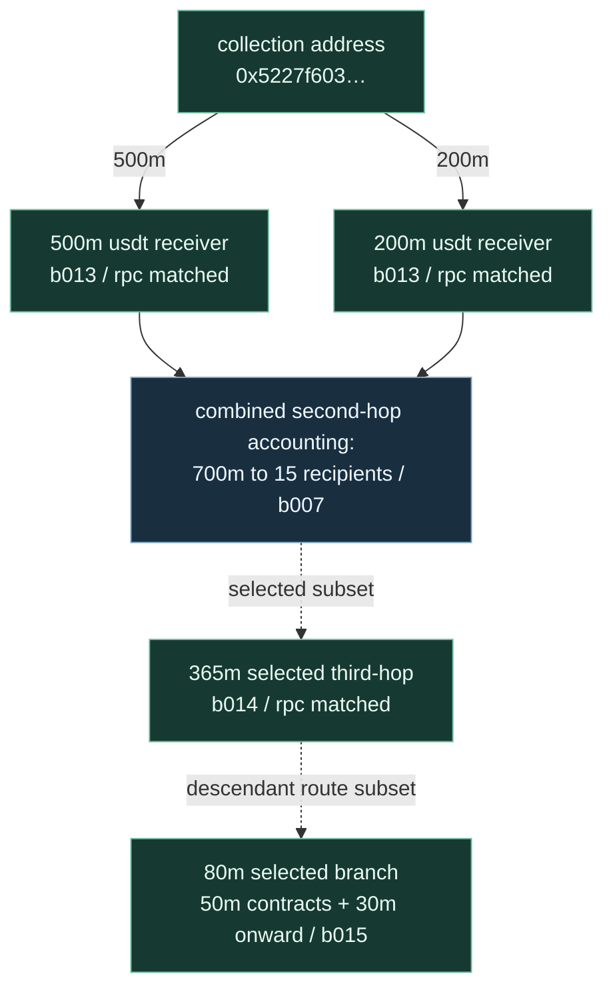

# the binance breach: from intrusion to asset movement

> npcsignals · visual research guide · incident of 29 october 2026 · documented through 7 november 2026

## begin with three questions

**how did the breach happen?** binance's preliminary account describes compromised developer environments, later access to wallet engineering systems and malicious deployment. these steps are **company-reported**; npcsignals has not independently reconstructed endpoint forensics.

**what moved?** our retained ethereum work checks a specific **700 million canonical-usdt first hop** against transfer receipts from two public rpc endpoints. other routes have different evidence levels.

**who was responsible?** the fbi's 31 october statement attributes the wider attack to **north korea / tradertraitor**. this is **official attribution**, not independent npcsignals verification of wallet operators.

the incident-wide estimate of approximately **$6.34 billion** is from binance's preliminary report, **not** an independently reconciled total in this archive.

## 01 / chronology — from access to the first week

**read the dates carefully:** the later-reported compromises are reconstructed from binance's 3 november report. the blockchain transaction events occurred on 29–30 october; the 31 october fbi statement is a subsequent attribution. this is a chronology of evidence, **not** proof that every box caused the next.

sources: [binance technical report](https://www.binance.com/en-AU/blog/community/3229153443759566763) · [b016 official attribution](./b016-fbi-attribution-20261101.md) · [b017 weekly source annex](./b017-weekly-developments-2026-11-01-to-07.md).

## 02 / the reported mechanism

according to binance, malicious developer tooling and a fraudulent recruitment assignment preceded access to wallet-team systems. **eip-7702** is an ethereum mechanism for delegated account execution. an observed authorization transaction and a later token transfer are *different* events. their connection cannot be established solely from the fact they occurred near each other.

source: [binance technical reconstruction, 3 november](https://www.binance.com/en-AU/blog/community/3229153443759566763) · [technical incident timeline](./index.html).

## 03 / the 700m usdt trail

**the boxes for b007 and b014 are accounting groups, not individual wallets.** their convergence in the diagram does **not** mean the funds physically merged at one address. the dotted subset connections do not assert direct transactions between those aggregate boxes. the complete observed branches, event logs and confidence levels are in [flow.html](./flow.html), [b007](./b007-second-hop-usdt-ledger.json), [b013](./b013-independent-rpc-usdt.json), [b014](./b014-independent-rpc-third-hop.json) and [b015](./b015-independent-rpc-80m.json).

**do not add 700m + 365m + 80m + 30m.** these are repeated movements of funds already counted at earlier stages. a token's name is not evidence of its identity; compare its ethereum contract with the [canonical-usdt identifier and collision evidence](./receiver-label-collision.json). a transfer into a liquidity contract does not by itself prove a swap or cash-out.

## 04 / reported developments 1–7 november

| measure | reported value | interpretation |
|---|---:|---|
| incident-wide affected assets | approximately **$6.34bn** | preliminary binance estimate; not independently reconciled here |
| frozen / intercepted | approximately **$2.8–2.85bn** | overlapping, differently timed binance / chainalysis estimates; not additive |
| replenished amount | approximately **98%** by 4 november | binance's replacement of impacted assets using its own resources, **not** 98% recovered from the actor |
| stablecoin conversion | about **$325m** to approximately **$285m in eth** | chainalysis-reported route; not replayed independently by this archive |

withdrawal services resumed in stages, rather than at one instant. for source publication dates, exact scope and limitations see [b017 weekly annex](./b017-weekly-developments-2026-11-01-to-07.md).

## 05 / glossary and educational use

| term | what it means here |
|---|---|
| **wallet address** | a public blockchain location; its appearance does not identify a person |
| **transaction hash** | an identifier used to retrieve an on-chain transaction |
| **rpc receipt** | a source of transaction status and token-event logs; b013–b015 preserve checks for selected transfers |
| **eip-7702** | an account-delegation mechanism on ethereum; authorization and asset transfer are separate events |
| **frozen assets** | assets blocked from movement; not necessarily returned |
| **replenished assets** | replacement from the platform's funds, rather than a direct recovery from the attacker |

a class can begin with the [plain-language case guide](./case-guide-start-to-2026-11-07.md), then use the [original transaction archive](./index.html) and [interactive selected route reconstruction](./flow.html) to inspect the evidence. investigators should also read the [documentation standard](./documentation-standard.md) and use the dated source identifiers.

**limits:** selected transfers are checked; all chains, historical token freeze states, ultimate ownership, the direct fbi-list overlap, and the final destination of every asset remain unestablished in this snapshot.

*observe. trace. verify.*
